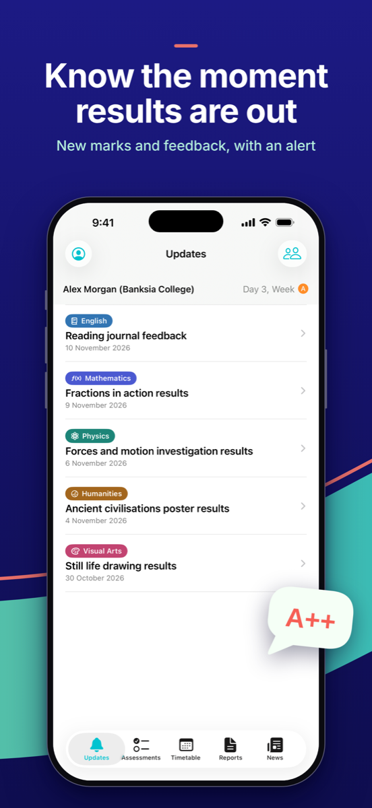
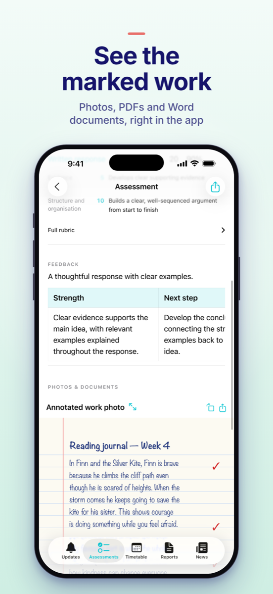
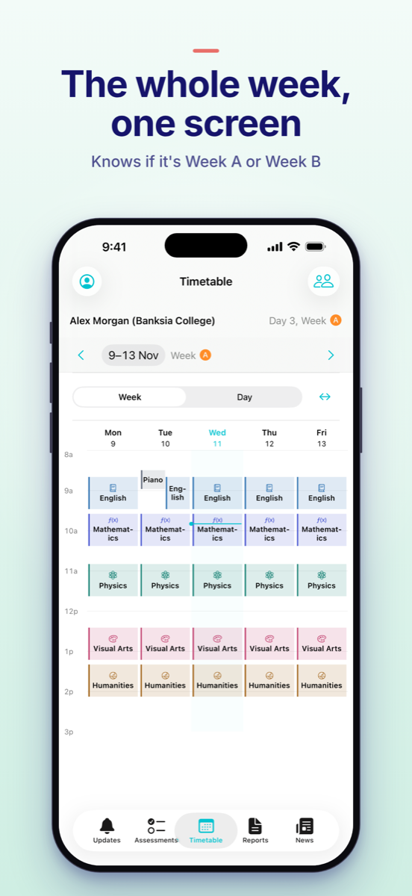
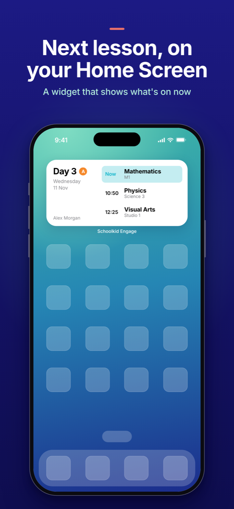

# Schoolkid Engage

A calm iPhone and iPad app for parents at schools that use SEQTA Engage, with lunch orders for schools whose
canteen uses My Student Account, plus **LMSKit** and **CanteenKit**, the Swift packages it's built on.

- Updates feed, with alerts and a badge for new assessment results and feedback
- Results with marks, rubrics, teacher feedback and attached photos, PDFs and Word documents
- Upcoming work, with overdue items flagged
- Week and day timetables that know the school cycle ("Day 3, Week A"), plus Home Screen and Lock Screen widgets
- School news and academic reports, with unread counts
- Lunch: the canteen balance, ordering a day's lunch from it, and what it's been spent on (My Student Account)
- Several children and schools, each kept separate

| | | | |
|:-:|:-:|:-:|:-:|
|  |  |  |  |

Screenshots use the app's fictional demo.

It never submits work or sends messages; the only thing it sends is a lunch order you place. It has no server of
its own: it talks only to your school and its canteen site, and card payments happen on the canteen's own page. See
[privacy](docs/PRIVACY.md). Need help? See [support](SUPPORT.md).

## Run it

Requires Xcode 26 or later and iOS 17 or later. Open `SEQTADisengage.xcodeproj`, choose the `SEQTADisengage`
scheme and a simulator, and run. Tap **Explore the demo** to try it with fictional data, no account needed.

To run on a device, set your own team under Signing & Capabilities (and change the bundle and App Group
identifiers if needed). `project.yml` is the project source; regenerate with [XcodeGen](https://github.com/yonaskolb/XcodeGen)
after changing targets or settings:

```sh
xcodegen generate
```

## Tests

```sh
swift test
xcodebuild -project SEQTADisengage.xcodeproj -scheme SEQTADisengage \
  -destination 'platform=iOS Simulator,name=iPhone 17 Pro' \
  -test-timeouts-enabled YES -default-test-execution-time-allowance 120 test
```

UI tests use the fictional demo and never contact a real school.

## LMSKit and CanteenKit

Add this directory as a Swift package. It has no third-party dependencies.

- **LMSKit**: children, the updates feed, news, timetable, assessments and reports, behind an `LMSService` protocol.
  SEQTA (`SEQTAClient`) is its provider.
- **CanteenKit**: canteen balances, menus and lunch orders, behind a `CanteenService` protocol. My Student Account
  (`MSAClient`) is its provider.
- **SchoolCore**: what both share (JSON, the HTTP transport, Keychain storage), re-exported by each.

```swift
import LMSKit

let client = SEQTAClient(school: try School("https://engage.yourschool.edu.au"))
let account = try await client.signIn(.password(username: username, password: password))
let children = try await client.children()
let upcoming = try await client.upcomingAssessments(for: children[0])
```

## Independence

Schoolkid Engage is an independent project. It is not made by, affiliated with or endorsed by SEQTA,
Education Horizons or any school. SEQTA is a trademark of its owner.

## Licence

[MIT](LICENSE) © 2026 Geoff Watts
